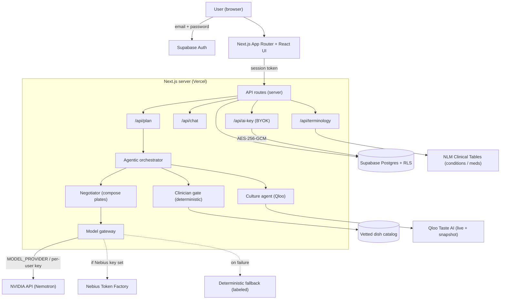
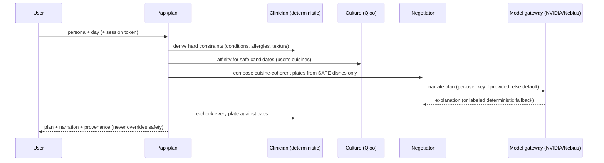

# NaniAI 🌍🍲

**Your personal, culturally-aware, health-safe food companion — worldwide.**

NaniAI plans meals that respect **your health limits** *and* **your culture**. It pairs a
**deterministic clinical-safety gate** with **Qloo's cultural taste graph** and a real
**NVIDIA open-source model (Nemotron)** so its advice is simultaneously *safe* and *familiar* —
the version of a dish you already love, adapted to your conditions, anywhere in the world.

- **Live demo:** https://naniai-vi-me.vercel.app
- **Default AI:** real NVIDIA Nemotron inference (live status at `/api/model/health`)
- **Global:** 130+ selectable cuisines, 120+ countries, a vetted multi-cuisine dish catalog, and
  country-appropriate emergency guidance.

> Runs end-to-end in a **keyless deterministic mode** for local dev, lights up the **live Qloo**
> taste graph when a Qloo key is present, and routes language reasoning to **any OpenAI-compatible
> model** — NVIDIA's API by default, or **Nebius Token Factory** — via one env switch or a per-user key.

---

## What you can do

- **Create a private account** (email + password). Your health profile is isolated per-user by
  Postgres Row-Level Security.
- **Onboard one question at a time:** name, age, the **cuisines you love** (searchable, global,
  free-text), favourite dishes, allergies, **any** condition or medication (live medical-terminology
  search, not a fixed list), spice/texture, lifestyle & schedule, **home country**, an optional
  emergency contact, and an optional **Nebius Token Factory key**.
- **Get a safe, familiar, globally-diverse day** — breakfast, lunch, snack, dinner — with the
  current meal highlighted and the next meal's prep surfaced.
- **Coherent complete plates** (main + accompaniments that match the cuisine), serving-size scaling,
  a merged grocery list, recipe detail pages, and a DB-persisted prep checklist.
- **Ask NaniAI** anything about food/cooking/nutrition — answered by the real NVIDIA model with your
  profile as context and deterministic safety guardrails (medication/emergency questions are routed,
  never model-cleared).
- **Emergency:** one tap opens WhatsApp to your trusted contact with a prefilled message, plus a
  calming breathing guide and **country-specific helpline numbers**.
- **Bring your own key (optional):** add your own **NVIDIA** or **Nebius Token Factory** key in
  Profile — encrypted at rest, used only for your requests.

---

## Architecture

### System overview



### Meal-plan request flow



**Invariant:** the clinician safety gate is the final authority. Qloo, external data, and the LLM
can rank and explain — they can **never** override an allergy, clinical, or texture decision.

---

## Tech stack

Next.js 15 (App Router) · React 19 · TypeScript · Supabase (Postgres + Auth + Row-Level Security) ·
Qloo Taste AI™ · NVIDIA Nemotron (OpenAI-compatible) · Nebius Token Factory (optional) · Vercel.

---

## AI providers (explicit & honest)

The model gateway (`lib/modelGateway.ts`) is provider-neutral and **never guesses** the provider
from a model name. `/api/model/health` reports the real provider, model, host, and `infra`
classification (`nvidia-api` / `nebius` / `other`).

| Mode | How | Used for |
|---|---|---|
| **NVIDIA (default)** | `MODEL_PROVIDER=nvidia` + `LLM_BASE_URL`/`LLM_API_KEY`/`LLM_MODEL` | Built-in reasoning for chat + plan explanations |
| **Nebius Token Factory** | `MODEL_PROVIDER=nebius` + `NEBIUS_API_KEY` + `NEBIUS_MODEL` | Runs inference on Nebius infrastructure |
| **Per-user BYOK** | Profile → add your NVIDIA or Nebius key (encrypted) | That user's requests only |
| **Deterministic fallback** | Automatic on failure / no config | Clearly labeled "mock" — **never** passed off as live AI |

`npm run verify:nebius` makes a real request and **fails** unless it genuinely hits a Nebius host —
so a Nebius claim can't be faked.

---

## Security & privacy

- **Per-user isolation:** `profiles`, `meal_prep`, and `user_api_keys` all enforce
  `auth.uid()` Row-Level Security — a user can only read/write their own rows.
- **Encrypted BYOK:** user API keys are encrypted with **AES-256-GCM** using a server-only
  `BYOK_ENCRYPTION_KEY`; the key is never returned to the browser, logged, or stored in plaintext.
  If the encryption secret is absent, the feature **fails safe** (never stores plaintext).
- **Cross-account safety:** signing out wipes all per-user in-memory state; a stale in-flight
  response can't repopulate another account's view (identity-guarded). Covered by an automated
  Playwright suite (`test:isolation`).
- **Secrets** live only in env (`.env.local`, host env) — never committed.

---

## Data & honesty

- **Nutrition values are clearly-labeled estimates** (shown as "Estimated"), not lab-measured —
  used for guidance, never as a medical claim. We never fabricate sourced nutrition.
- **Qloo** provides the cultural taste signal (live + a committed snapshot for instant hosting);
  internal popularity metadata is kept out of user-facing text.
- **Medical terminology** search uses the free NLM Clinical Tables API and sends only the typed term.

---

## Setup

```bash
npm install
cp .env.example .env.local   # fill in what you want to enable (all optional for mock mode)
npm run dev
```

### Environment variables (names only — never commit real values)

| Variable | Purpose |
|---|---|
| `NEXT_PUBLIC_SUPABASE_URL`, `NEXT_PUBLIC_SUPABASE_ANON_KEY` | Supabase client (browser-safe) |
| `SUPABASE_SERVICE_ROLE_KEY` | Server-only admin (migrations, user cleanup) |
| `POSTGRES_URL_NON_POOLING` | Direct Postgres URL for the migration runner |
| `MODEL_PROVIDER` | `nvidia` \| `nebius` \| `mock` |
| `LLM_BASE_URL`, `LLM_API_KEY`, `LLM_MODEL` | NVIDIA / OpenAI-compatible provider |
| `NEBIUS_BASE_URL`, `NEBIUS_API_KEY`, `NEBIUS_MODEL` | Nebius Token Factory provider |
| `BYOK_ENCRYPTION_KEY` | 32-byte server-only key for encrypting per-user BYOK keys |
| `QLOO_API_KEY`, `QLOO_BASE_URL` | Live Qloo taste graph (optional) |

### Database migrations

Run in order (Supabase SQL editor, or the runner):

```bash
node --env-file=.env.local scripts/run-migration.mjs supabase/migrations/0001_init.sql
# 0002_meal_prep.sql · 0003_profile_feedback.sql · 0004_user_api_keys.sql · 0005_user_api_key_model.sql
```

| Migration | Adds |
|---|---|
| `0001_init` | `profiles` + RLS |
| `0002_meal_prep` | per-user meal-prep checklist + RLS |
| `0003_profile_feedback` | meal feedback (off-device) |
| `0004_user_api_keys` | encrypted BYOK keys + RLS |
| `0005_user_api_key_model` | optional BYOK model id (Nebius) |

---

## Testing

| Command | Checks |
|---|---|
| `npx tsc --noEmit` | Types |
| `npm run lint` | ESLint (Next + TypeScript) |
| `npm run test:schedule` | Time-aware meal scheduling (pure) |
| `npm run eval` | Clinical safety gate — expects **0 violations** across personas |
| `npm run test:isolation` | Cross-account isolation E2E (Playwright, mocked auth) |
| `npm run test:aikey` | Live BYOK round-trip (encrypted-at-rest, cross-user isolation) |
| `npm run verify:nebius` | Strict Nebius inference check (fails on NVIDIA's API) |
| `npm run test:rls` | Live RLS verification on a dedicated staging project (see `STAGING.md`) |
| `npm run build` | Production build |

---

## Project structure

```
app/            # App Router pages + API routes (plan, chat, ai-key, terminology, catalog, model/health)
lib/agents/     # orchestrator, clinician (safety), culture (Qloo), negotiator (plates)
lib/data/       # vetted dish catalog
lib/qloo/       # live Qloo client + committed snapshot + deterministic mock
lib/crypto/     # AES-256-GCM secret box (BYOK)
lib/modelGateway.ts   # provider-neutral model gateway (NVIDIA / Nebius / mock)
supabase/migrations/  # SQL migrations
scripts/        # migration runner, Nebius/RLS/BYOK verification
tests/          # account-isolation Playwright suite
docs/hackathon/ # submission materials
```

---

## License

[MIT](LICENSE).

## Acknowledgements

Cultural taste intelligence by **Qloo**. Language reasoning by **NVIDIA** open models (Nemotron),
runnable on **Nebius Token Factory**. Medical terminology from the U.S. **National Library of
Medicine** Clinical Tables. NaniAI never claims medical clearance from a model — safety is
deterministic.
