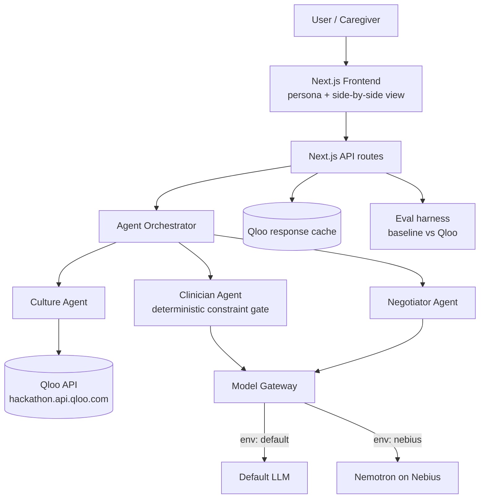
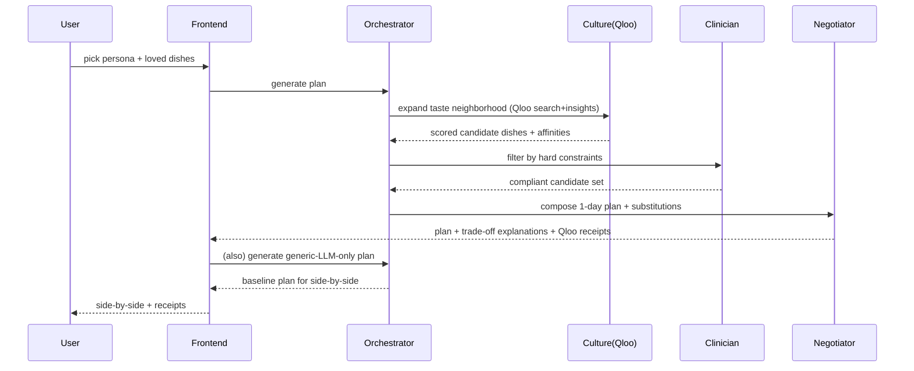

# NaniAI — Culturally-Grounded Meal & Daily-Life Agent for Seniors with Health Constraints

**Date:** 2026-10-27
**Status:** Design — awaiting user review
**Author:** (you) + mentor
**Targets:** Qloo Hackathon (primary, deadline Oct 30 2026 11:45pm EDT) · Nebius × NVIDIA Global AI Hackathon (secondary, deadline Oct 30 2026 10:00am PDT)
**Dropped:** Agentic Hackathon (Bangladesh-only finale — not eligible)

---

## 1. Problem & insight

Dietary and daily-life advice for seniors with health conditions fails in practice not because the medicine is wrong, but because it is **culturally blind**. Telling a South Indian diabetic grandmother to eat kale is "technically functional." Offering her a millet version of a dish she already loves is "actually good." Adherence tracks familiarity and taste, not nutritional correctness alone.

**Core insight:** The hard part is reconciling two forces that generic LLMs blur together — *non-negotiable medical constraints* and *deeply personal cultural taste*. Qloo's taste graph supplies the second force with real grounding; a deterministic clinician gate supplies the first. The product lives in the negotiation between them.

**Qloo load-bearing test (passed):** Remove Qloo and the agent collapses every user to a generic "Mediterranean/DASH" template. With Qloo, it finds the user's actual taste neighborhood and the culturally-adjacent dishes nearby, then filters by constraints. The degradation is visible and measurable — that is the demo.

## 2. Target users

- **Primary (hero persona for demo):** A seded senior with a chronic dietary condition and a strong food culture (e.g., 72-yr-old, Type 2 diabetes + mild hypertension, South Indian cuisine, soft-food texture need).
- **Secondary:** Adult-child caregiver arranging meals for a parent.
- Demo scope: **one persona, one day, one cuisine, done perfectly.**

## 3. Product (MVP)

A hosted web app:
1. User selects/edits a persona (conditions, meds, texture level, cuisine/culture, a few loved dishes).
2. Agent returns a **1-day meal plan** that is (a) constraint-safe, (b) culturally familiar via Qloo, (c) shown **side-by-side with a generic-LLM-only plan**, (d) annotated with **groundedness receipts** citing the Qloo entities/affinities used.
3. When a loved dish violates a constraint, the agent shows a **taste-preserving substitution** with a plain-language trade-off explanation.

## 4. The agentic workflow (not a chatbot)

Three cooperating agents:

1. **Clinician agent** — deterministic hard-constraint gate (sugar/sodium caps, med–food interactions, texture/IDDSI level, allergies). The LLM cannot override it; it filters the candidate set.
2. **Culture agent (Qloo-powered)** — scores candidate dishes by cultural/taste affinity to the user profile using Qloo Insights/Search/Tags.
3. **Negotiator agent** — reconciles the filtered + scored candidates into a plan; on conflict, proposes the nearest taste-preserving compliant substitution and explains the trade-off.

## 5. Novelty points — FINALIZED 7 (all MVP)

1. **Taste-Preserving Substitution Engine** — given a loved dish + a violated constraint, return the nearest *culturally-adjacent* compliant dish via Qloo affinity, not a random healthy dish. *Baseline-testable.* (Qloo + Nebius)
2. **Hard-Constraint Clinician Gate** — deterministic safety filter the LLM cannot override; filters the candidate set before the model ever ranks it. *Reliability/safety/failure-recovery.* (Both)
3. **Multi-Agent Negotiation with visible trade-off explanations** — Clinician ↔ Culture ↔ Negotiator; conflicts surfaced in plain language, not hidden. *The agentic workflow.* (Both)
4. **Live "Generic LLM vs Qloo-grounded" side-by-side toggle** — the live-demo wow moment; directly answers Qloo's "show the difference" requirement. *Live visual wow.* (Qloo)
5. **Groundedness Receipts** — every suggestion cites the exact Qloo entities/affinities used, or honestly says "cultural match unavailable." *Testable: % of recs with valid citations; honesty under failure.* (Qloo)
6. **Cultural Familiarity Score (0–100 per dish)** — a numeric, visible score derived from Qloo affinity, shown on every dish and aggregated per plan. *Baseline-testable: score with Qloo on vs off.* (Qloo)
7. **Portable Model Gateway with live latency/cost panel** — one agent, two interchangeable "brains" (default LLM vs **Nemotron on Nebius**), selected by env var, with a live latency/cost comparison panel. Makes the Nebius edition a real engineering artifact, not a mention. *Measurable: latency + est. cost per plan per provider.* (Nebius)

**System interlock:** 1+2+3 form one technical system (the negotiation engine); 1+5+6 are baseline-testable; 4 is the live wow; 2 is safety/reliability; 7 is the cross-hackathon portability spine. Covers every structural requirement of the master brief's Phase 4, scoped to ship + prove in 3 days.

**Roadmap (P2 — mentioned in submission, not built now):** IDDSI texture personalization; feedback loop re-weighting taste vs constraint; caregiver shared view/export; medication-timing-aware scheduling; private on-device preference memory (future Nebius "Personal AI" angle).

## 6. Two editions, one codebase (~90% shared)

| Layer | Qloo edition | Nebius × NVIDIA edition |
|---|---|---|
| Frontend | shared Next.js UI | shared + latency/cost panel |
| Agent orchestration | shared | shared |
| Reasoning model | default LLM via model gateway | **Nemotron (or other NVIDIA open model) on Nebius** via same gateway |
| Cultural brain | Qloo API | Qloo API (same) |
| Extra deliverable | live baseline toggle | 3-min YouTube demo video |

The **model gateway** is the only swap point — a single interface with two providers selected by env var. Nemotron's role is *meaningful*: it runs the Clinician reasoning + Negotiator synthesis, not a cosmetic call.

## 7. Qloo integration (verified facts + flow)

- **Base URL:** `https://hackathon.api.qloo.com` (verified from hackathon dev guide).
- **Key:** manually approved, "typically a few business days" — **requested Day 0, build against mock adapter until it arrives.**
- **Endpoints used:** Insights API (recommendations/affinities), `/search` (entity lookup), `/v2/tags` (valid tag IDs for filters). **Do NOT use `/recommendations` or `/recs`** (legacy, unsupported).
- **Flow:** persona cuisine + loved dishes → `/search` to resolve entities → Insights to expand to culturally-adjacent dishes/affinities → Culture agent scores → Clinician gate filters → Negotiator composes.
- **Caching:** cache Qloo responses per (entity, filter) to stay within quota and keep the demo fast/deterministic.
- **Failure handling (honest):** if Qloo returns no/low results for an entity, the UI says so explicitly and falls back to a clearly-labeled "cultural match unavailable" state — never fabricated affinities.

## 8. Architecture

## 9. Evaluation (lightweight but real — no fabricated numbers)

Small, honest harness run *after* build:
- **Dataset:** ~10–15 persona × constraint cases across the demo cuisine(s).
- **Baseline:** same prompt, Qloo disabled (generic LLM only).
- **Metrics:** (1) cultural-affinity score of recommended dishes (Qloo on vs off), (2) % recommendations with valid Qloo citations, (3) hard-constraint violation rate (must be 0 via gate), (4) latency + est. cost per plan (default vs Nemotron). Report real numbers with sample size + limitations.

## 10. MVP acceptance criteria

- [ ] Hosted public URL, works end-to-end for ≥1 persona (no local-only).
- [ ] 1-day plan is constraint-safe (0 violations in demo cases).
- [ ] Side-by-side generic-vs-Qloo view renders and visibly differs.
- [ ] Each recommendation shows ≥1 valid Qloo citation (or honest "unavailable").
- [ ] At least one taste-preserving substitution with trade-off text.
- [ ] Public repo + OSS license visible + README with setup.

## 11. Tech stack & repo

- **Stack:** Next.js + TypeScript, API routes for the agent layer, deploy on **Vercel**.
- **Model gateway:** single TS interface; providers = default LLM + Nebius (OpenAI-compatible endpoint).
- **License:** **Apache 2.0** (satisfies both Qloo's OSS requirement and Nebius's Apache/MIT/MPL requirement; visible at repo top + About section).
- **Secrets:** all keys server-side only (env vars / Vercel project settings); never in frontend, never committed.
- **Repo structure (draft):** `/app` (Next.js), `/lib/agents`, `/lib/qloo`, `/lib/modelGateway`, `/lib/eval`, `/data/personas`, `/README.md`, `/LICENSE`.

## 12. Highest-risk assumptions

1. Qloo key arrives before Oct 30 — mitigate: request Day 0 + mock adapter + Discord expedite.
2. Nemotron available on the user's Nebius account — mitigate: verify in console first; else swap to another hosted NVIDIA open model.
3. Qloo food/dining coverage rich enough for the substitution demo — mitigate: pre-verify 2–3 cuisines' entity coverage.
4. Solo + 3 days + two hosted apps + one video — mitigate: brutal MVP scope, shared codebase, one-click deploy.

## 13. Explicitly out of scope for MVP

Multi-day plans, grocery/ordering integration, real user accounts/auth beyond demo, mobile app, the P2 roadmap items above.
